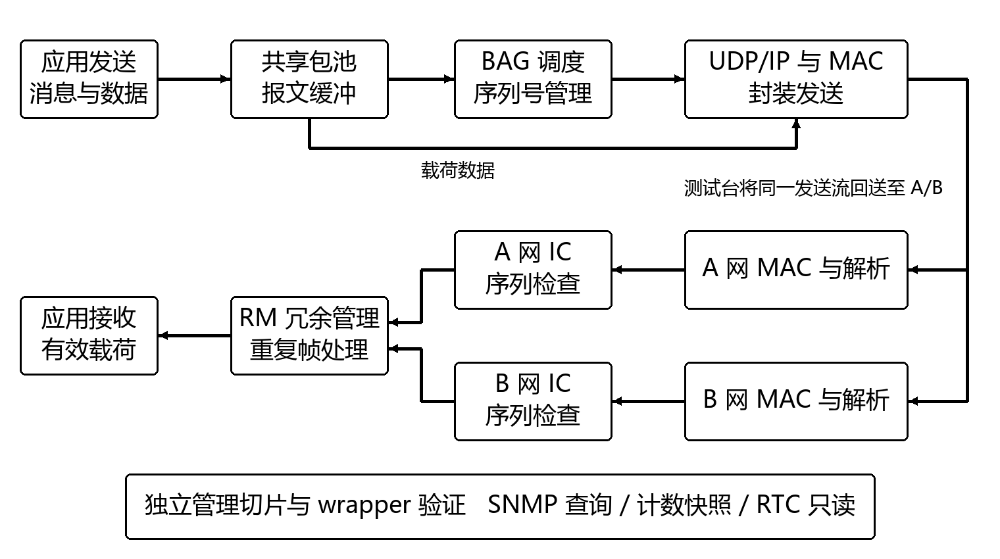
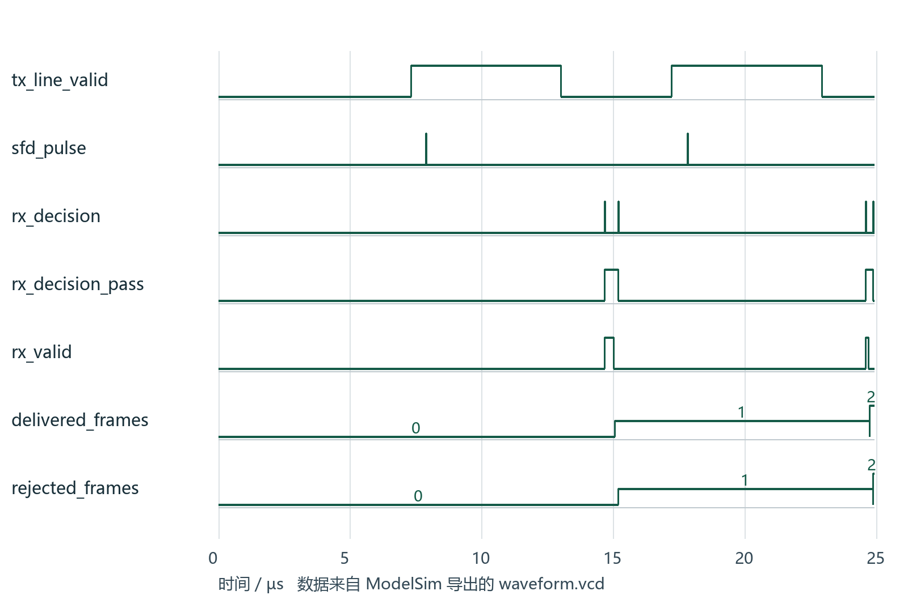

# AFDX FPGA 端系统

基于 FPGA 的 AFDX 端系统工程初版，包含共享报文缓存与发送调度、双网接收、完整性检查、冗余管理，以及独立管理功能切片。

本仓库提供 RTL、测试台、验证脚本与可重新运行的 ModelSim 波形示例。当前成果为计算机行为仿真与内部实现证据，**尚未上板**。

## 从这里开始

- **看作品**：[作品报告 PDF](docs/作品报告.pdf) · [可编辑 Word](docs/作品报告.docx)
- **看设计**：下方系统框图与 [RTL 源码](rtl/)
- **看它怎样运行**：[ModelSim 仿真工程](simulation/) · [仿真操作说明](docs/SIMULATION.md)
- **查看限制**：[当前实现边界](#当前实现边界)

## 系统设计



发送方向：应用报文进入共享包池，按虚拟链路和 BAG 约束调度，完成 UDP/IP/以太网封装并输出线路字节流。接收方向：A/B 两网分别完成接收、解析和完整性检查，再经冗余管理决定是否交付应用。

图中的 A/B 分支是**测试台回送**，不表示主版本已实现双网发送。管理面通过独立 wrapper 验证，未纳入 E5 主链路时序结论。

## 已实现功能

| 部分 | 已有实现与验证范围 |
|---|---|
| 共享发送 | 64 槽包池、BAG 调度、按 VL 管理序列号、UDP/IP/MAC 封装；128 TX VL 发送测试 |
| 双网接收 | A/B 独立启动与接收、FCS 检查、序列完整性检查和冗余管理；当前每网 8 VL 子集 |
| 参数化时基 | 支持 100MHz/8 拍与 50MHz/4 拍，两者名义字节时间均为 80ns |
| 管理切片 | 寄存器、计数快照、SNMP v1 最小查询子集、RTC 只读；615A 最小代理单元验证 |
| 验证 | Verilog/C++ 测试台、Python 自动回归、ModelSim 波形与日志 |

## 运行一次真实仿真

当前推荐使用 Windows + ModelSim Intel FPGA Starter 10.5b。在纯英文、可写路径下克隆或解压工程，例如 `C:/work/afdx-fpga`。

```powershell
cd simulation
.\打开波形.cmd          # 先看已生成的真实波形
# 关闭波形窗口后可重新编译、运行：
.\重新运行仿真.cmd
```

启动文件会先查找本机原安装目录，再查找 PATH。安装位置不同，可修改启动文件中的 `MSIM`。本机已验证此 ModelSim 入口，其他系统与工具版本未验证。详细命令见 [仿真操作说明](docs/SIMULATION.md)。

这个示例使用 **50MHz/4 拍**，发送两帧，分别属于 VL0/VL1，载荷为 17B/5B。两网接收同一发送流后，应当得到：

```text
PASS tb_afdx_system delivered=2
FINAL_DELIVERED=2
FINAL_REJECTED=2
```



上图直接绘制随仓库提供的 `simulation/waveform.vcd`，不是示意数据。两帧应用交付和两帧重复副本拒绝可在末态计数中核对。测试台补充了 10 拍结束等待，使寄存计数稳定后再记录波形；被测 RTL 未改。

## 主要验证结果

以下结果来自不同配置的对应测试，不能拼接为同一配置的硬件满速长稳结论。完整条件和未完成项见作品报告。

| 项目 | 结果 | 条件 |
|---|---|---|
| 候选内部时序 | Fmax 50.264MHz，最小余量 +0.105ns | E5、50MHz/4；未含板级 IO 预算 |
| 仿真持续吞吐 | 长帧 99.22、短帧 82.84、混合帧 73.70Mbit/s | 50MHz/4 行为仿真 |
| 长稳环回 | 10,000 帧全部交付，坏 FCS、载荷与序列违规均为 0 | 100MHz/8、4 VL |
| 时延样本 | 无背压最大 151.56µs | 100MHz 开发配置；不是最坏界证明 |
| 615A 最小代理 | 2,866 项检查通过 | 独立字节流单元；未接 UDP 管理通道 |

小型波形示例不能替代容量、长稳或原生时序测试。仓库保留主链路示例的原始波形与日志；大型历史工具产物不在仓库中。

## 目录

```text
rtl/          FPGA 逻辑源码，含 TX、RX、缓冲、管理与顶层
tb/           Verilog 和 C++ 测试台
scripts/      构建、回归与原生工具脚本
simulation/   已验证的 ModelSim 主链路示例与波形
config/       配置
constraints/  约束
models/       模型
vectors/      测试数据
elinx/        E5 候选包装顶层
third_party/  Verilator 配套源文件、头文件与原许可证
docs/         作品报告、图表和操作说明
```

`rtl/` 为开发主线完整逻辑，`simulation/` 为方便独立编译保留的主链路平铺副本。联合顶层默认参数为 100MHz/8，示例测试台显式选择 50MHz/4。

Python 回归仍包含原工程的路径和工具安装假设，部分历史脚本还依赖未附带的 `reports/`。使用前须核对 `ROOT`、Verilator/MSVC、ModelSim 或 eLinx 路径；不承诺全部历史脚本均可直接运行。

## 当前实现边界

- 整机 100MHz 时序尚未签核；50MHz 候选内部时序通过不等于板级签核。
- 4096 RX VL 未实现，当前为每网 8 VL 的开发子集。
- 默认 RM expected-SN 关闭配置仍存在迟到副本可能再次交付的已知情形；本示例是受控到达顺序。
- 双网 TX 功能分支未作为本仓库主版本交付，其时序尚未通过。
- 615A 为最小代理，未接 UDP 管理通道；RTC 无同步伺服。
- 未完成板级 PHY、引脚与 IO 预算、门级仿真及上板测试，不声称完整 ARINC 符合性。

第三方组件保留原许可证，见 `third_party/`。本项目未为原创代码另行添加开源许可证。
